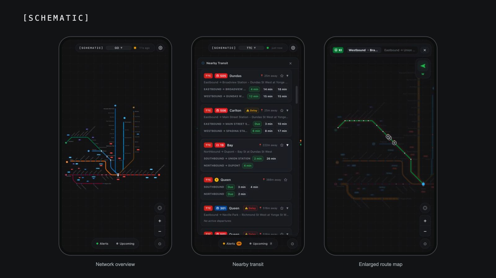

# [SCHEMATIC]

Schematic helps you check transit disruptions, station departures, and nearby buses and streetcars from your phone.

> [!NOTE]
> Schematic is an independent project and may contain mistakes in transit information. When a disruption or departure matters to your trip, check the operator's official information.

## What you can do

- Explore transit network maps and see disruptions, delays, and elevator outages.
- Find nearby stops and stations with live departure predictions.
- Follow a route and see live vehicle positions.
- Save favourite routes and stations, and set commute windows for disruption notifications.
- Install the app on your home screen. The app shell stays available offline; live departures and alerts need a connection.

Choose your transit agency, then explore its map or nearby departures. You can allow location access to find nearby transit or select an area manually. Available information depends on the agency's feeds; missing or stale data is shown in the app.

The [agency and data-source list](docs/data-attribution.md) is kept up to date from the app's registered agencies.

## Privacy

There are no app accounts or external analytics. Favourites stay on your device. If you enable commute notifications, your host also stores a push subscription, the relevant favourites, and your commute schedule to send matching alerts.

## Run your own copy or contribute

See the [hosting guide](docs/deployment/deployment-guide.html) to run your own instance. The optional alert proxy is only needed when your host cannot access an agency's alert feed directly, such as when the operator blocks Cloudflare or other cloud hosts. Residential self-hosting can fetch those feeds directly when accessible.

For local setup, development, or adding an agency, start with [Contributing](CONTRIBUTING.md).

Found a problem? [Report a bug](https://github.com/joncrangle/schematic/issues). Report security vulnerabilities privately using the [security policy](SECURITY.md).

## Transit data and licence

This is an independent project, not affiliated with or endorsed by any transit agency.

Transit data comes from the operators and public data sources declared in each agency manifest. See [data attribution](docs/data-attribution.md) for sources, licence labels, and acknowledgements. Each source's terms apply to its data separately from the application's software licence.

The application is licensed under [GNU GPLv3](LICENSE).
